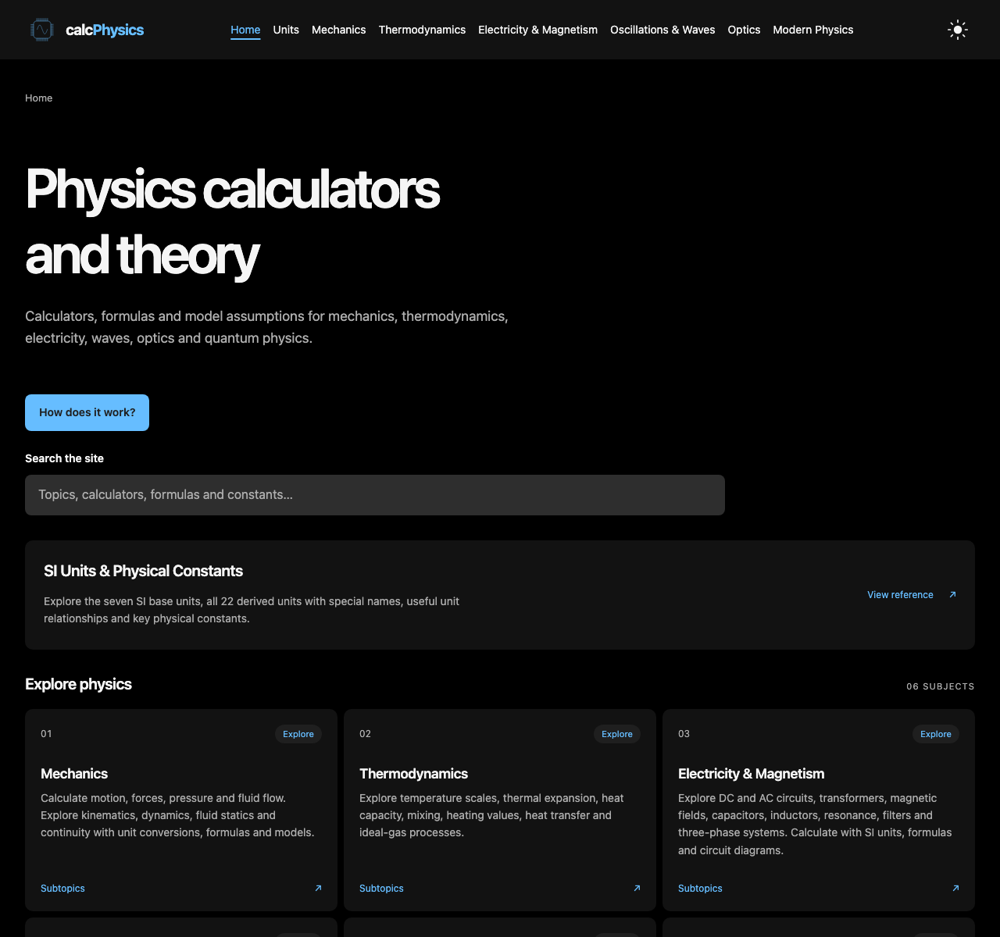
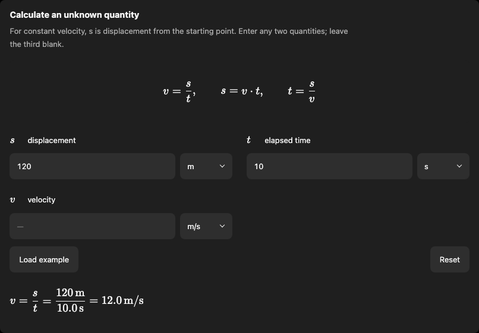

# calcPhysics ⚛️

Physics calculators and theory, available in English and German. Calculate unknown quantities, follow the formulas and explore diagrams across mechanics, thermodynamics, electricity, waves, optics and modern physics.

**[Open calcPhysics](https://calcphysics.com)** · **[Try the input guide](https://calcphysics.com/calculator-help)**

<table>
  <tr>
    <td></td>
  </tr>
</table>

## 🧮 What you can do

- Solve for different variables and follow the calculation steps.
- Enter expressions such as `(1 + 3) * 2` or `1k + 1m`, with unit conversion and SI prefixes.
- Explore model diagrams, orbital geometry and an interactive Bloch sphere.
- Search topics and look up SI units and physical constants.



## 🛠️ Run locally

Built with **SvelteKit, TypeScript and KaTeX**. Use Node.js **22.17+**; `.nvmrc` pins the tested version.

```sh
npm ci
npm run dev
```

Open the local URL printed by Vite. To validate changes:

```sh
npm run check
npm test
npm run build
```

Physics functions live in `src/lib/physics/`, model content in `src/lib/content/` and shared UI in `src/lib/components/`. Tests use Node’s built-in test runner.

## 📬 Feedback & contributing

Found a bug, a missing formula or an incorrect result? [Open an issue](https://github.com/jaduruch/calcPhysics/issues) or email [calcphysics@outlook.com](mailto:calcphysics@outlook.com).

Before contributing, read the [project rules](AGENTS.md) and [model page standard](docs/MODEL_PAGE_STANDARD.md). Internal documentation is in German. Check each model’s assumptions and verify results before practical use; see the [disclaimer](https://calcphysics.com/disclaimer).
